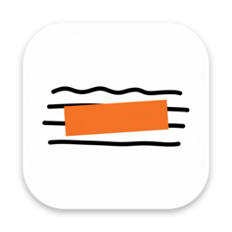
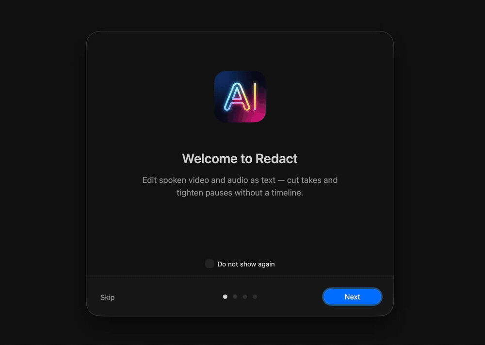

<h1>Redact</h1>

Edit videos by trimming the transcript. 
Cut takes, tighten pauses, clean up speech, and export without a timeline.

<strong>Version 2.0.1</strong> · macOS 14+ · Apple Silicon

  
  
  
  

<a href="https://github.com/madebysan/redact/releases/latest">Download Redact</a>

Redact is a Mac editor for podcasts, interviews, tutorials and other spoken media: you edit the words, and the video follows.

- Select words in the transcript and press Delete to cut them.
- Clean Up finds filler words, repeats and long pauses for you to review.
- Ask Codex or Claude Code for an edit and approve the proposed cuts.

## How it works

Import a video or audio file and Redact transcribes it on your Mac with [WhisperKit](https://github.com/argmaxinc/WhisperKit). Delete words, run Clean Up, or describe an edit to an agent; every change previews before you apply it and can be undone. Export as MP4, MKV, WebM, M4A, MP3 or WAV, as subtitles with adjusted timing, or as an EDL or Final Cut Pro XML cut list for Premiere Pro, Final Cut Pro and DaVinci Resolve. Features, formats and preferences are in [docs/how-it-works.md](docs/how-it-works.md).

## Privacy

Transcription and editing stay on your Mac. Agent editing is opt-in and shares only a transcript snapshot with the agent you choose, never the media or file paths. Redact checks for updates through [Sparkle](https://sparkle-project.org).

## Install

Download Redact from the [latest release](https://github.com/madebysan/redact/releases/latest) and drag it to Applications. It needs Apple Silicon and macOS 14. The first time you import or export, Redact offers to download FFmpeg (about 57 MB) and keeps it in its own Application Support folder; if you already have FFmpeg from Homebrew, Redact uses that instead. To build it, run `./script/build_and_run.sh`.

---

[MIT](LICENSE). Third-party components and their licenses are listed in [THIRD_PARTY_NOTICES.md](THIRD_PARTY_NOTICES.md).

Made by [santiagoalonso.com](https://santiagoalonso.com)
