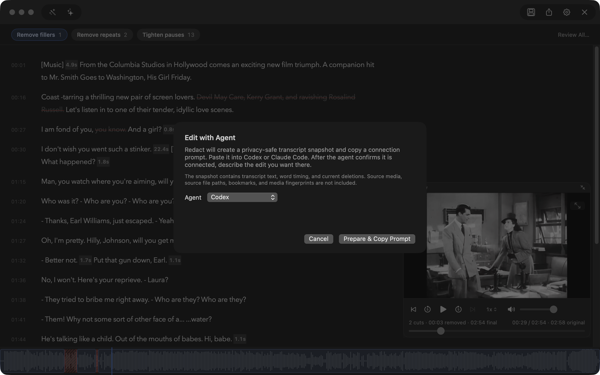
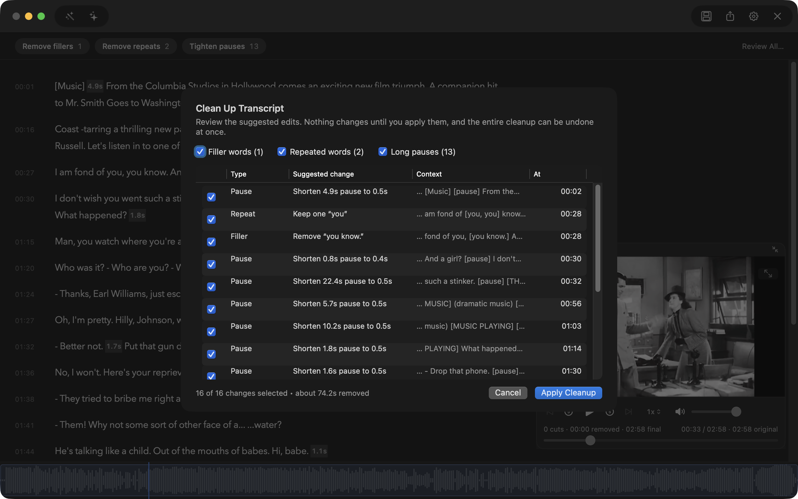

# How Redact works

Editing features, export formats, preferences and release tooling. The short version is the [README](../README.md).

## Editing

### Read and cut

The transcript reads as paragraphs of about three sentences, each with its start time in the margin. Select words and press Delete, or press X to cut or keep the whole sentence your selection is in, and Return to play it. Click a struck-out word to restore it, double-click a word to correct its text, and use Undo for everything else. Pauses show as small length chips inside the text; click one to tighten it and click again to restore it.

The preview floats over the bottom-right corner and plays the edited result. Drag it by its top strip, switch it between large and compact, or hide it with View > Hide Preview; Redact remembers where you left it. The waveform along the bottom draws the kept parts as blocks and the cuts as hatched red over the audio.

### Edit with Codex or Claude Code

Prepare a privacy-safe transcript snapshot, paste the connection prompt into Codex or Claude Code, and describe the edit you want. Redact shows the proposed cuts and new duration before applying everything as one undoable edit.



### Auto-trim pauses and filler words

Clean Up finds clear filler words, repeated words, and long pauses. The toggles above the transcript (Remove fillers, Remove repeats, Tighten pauses) apply every suggestion of one kind as a single undoable edit; point at one to see what it would remove, and click it again to restore. Review All opens the full list, where you choose suggestion by suggestion.



## Export formats

| Output | Video | Audio |
|---|---|---|
| MP4 | H.264 | AAC |
| MKV | H.264 | AAC |
| WebM | VP9 | Opus |
| M4A |: | AAC |
| MP3 |: | MP3 |
| WAV |: | PCM |
| SRT | Adjusted subtitle timing |: |
| EDL | CMX3600 cut list |: |
| FCPXML | Final Cut Pro XML 1.10 cut list |: |

The EDL and FCPXML sidecars hand the edit to another editor instead of rendering it: one event or clip per kept range of the original file, with timecodes at the source frame rate (drop-frame for 29.97 and 59.94) and the source file name for relinking. Premiere Pro and DaVinci Resolve import the EDL; Final Cut Pro and Resolve import the FCPXML. Audio-only sources get only the EDL, at 30 fps non-drop. The cut list describes the cuts at source speed and does not carry the export speed or audio enhancement.

## Preferences

Redact includes keyboard shortcuts for common editing, playback, project, and export actions.

Redact uses a dark interface only. Settings has three tabs. Transcript sets the font (14 built-in macOS families), text size, letter spacing, line spacing and playback highlight color, with a live sample and Restore Defaults. Transcription chooses the Whisper model and explains the trade-offs. Media Tools shows which FFmpeg Redact is using, with an Install or Reinstall action. Format, quality, speed, audio enhancement, and the optional subtitle, EDL, and FCPXML sidecars are remembered for the next compatible export.

## Building and releasing

From the repository root:

```bash
./script/build_and_run.sh
```

The native UI uses Swift and AppKit. AVFoundation handles preview playback and timeline mapping, [DSWaveformImage](https://github.com/dmrschmidt/DSWaveformImage) renders the waveform, and FFmpeg handles extraction and final media export.

### FFmpeg

Redact runs FFmpeg and FFprobe as separate processes and looks for them in this order: its own copy in `~/Library/Application Support/Redact/ffmpeg/`, Homebrew (`/opt/homebrew/bin`, `/usr/local/bin`), then your PATH. When neither tool is found, importing or exporting opens an Install FFmpeg sheet. Accepting it downloads the pinned static Apple Silicon build of FFmpeg 9.0.2 from [Martin Riedl's FFmpeg build server](https://ffmpeg.martin-riedl.de/) (two archives, about 57 MB), checks each archive against the SHA-256 published beside it, unpacks it, clears quarantine on the verified file only, runs `-version` as a smoke test, and only then moves both tools into place and continues the import or export. Settings shows which FFmpeg is in use and offers Install or Reinstall. The build is GPL-3.0 and is not part of the app bundle; see [THIRD_PARTY_NOTICES.md](../THIRD_PARTY_NOTICES.md). To exercise the in-app install on a Mac that already has Homebrew's FFmpeg, launch Redact with `REDACT_IGNORE_SYSTEM_FFMPEG=1`, which makes the lookup skip Homebrew and PATH. `REDACT_RUN_FFMPEG_INSTALL_INTEGRATION=1 swift test` runs the opt-in test that downloads the real build into a temporary folder and encodes with it.

### README screenshots

`scripts/readme-screenshots.sh` regenerates `assets/screenshot.png` and the two docs images from committed sources. It builds the Debug app, downloads the public-domain *His Girl Friday* (1940) trailer from Wikimedia Commons and checks its SHA-1, opens it in the Debug-only screenshot mode with fixed demo edits, and captures only Redact's window by its ID. The trailer is credited in [THIRD_PARTY_NOTICES.md](../THIRD_PARTY_NOTICES.md) and is never committed. It records the commit and version in `assets/screenshots-provenance.json`; `--draft` allows uncommitted sources and marks the record as a draft.

Release helpers live in `scripts/`:

```bash
./scripts/build-release.sh sign
./scripts/build-release.sh dmg
./scripts/build-release.sh release
./scripts/make-appcast.sh <dmg> <download-url> <release-notes.md>
```

Updates use [Sparkle](https://sparkle-project.org). `make-appcast.sh` writes `appcast.xml` for a notarized DMG, signed with the update key in the login keychain; upload it to the same GitHub release as the DMG.
