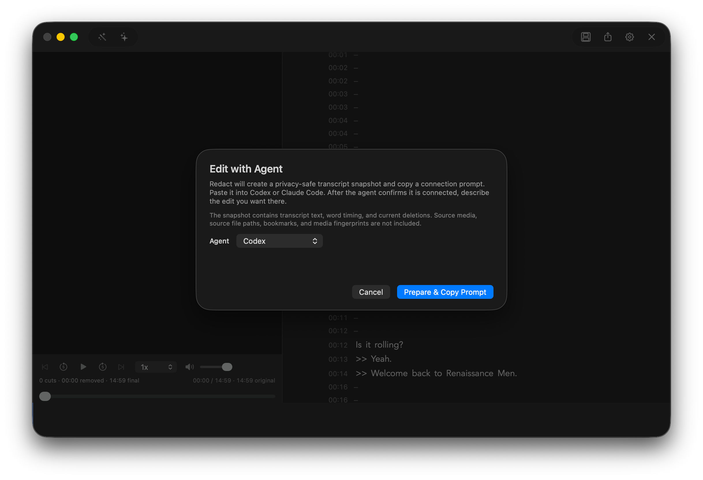
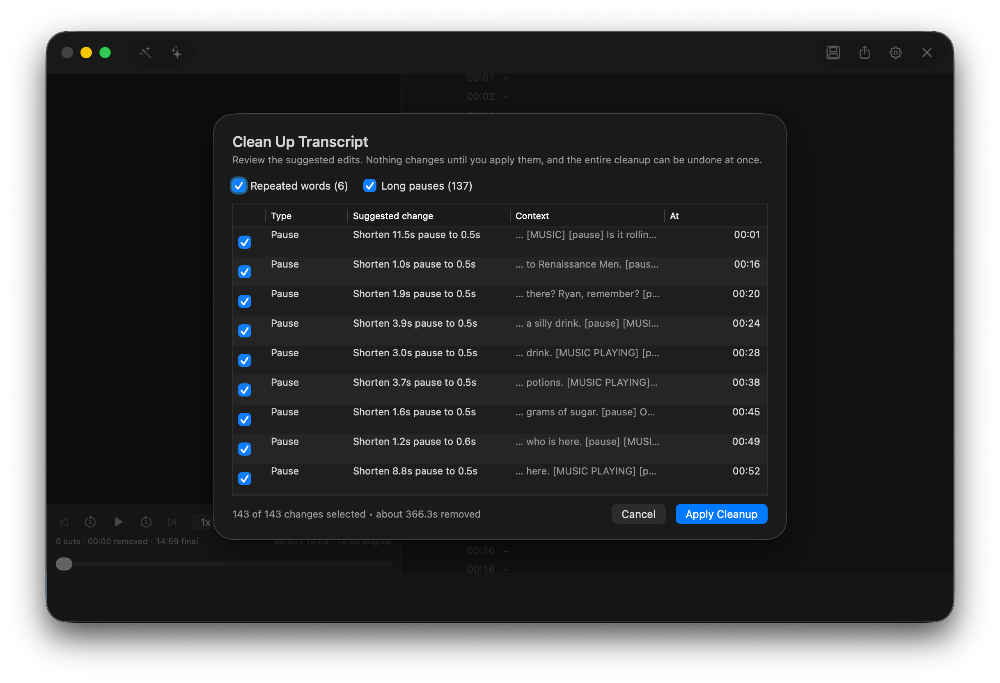

# How Redact works

Editing features, export formats, preferences and release tooling. The short version is the [README](../README.md).

## Editing

### Edit with Codex or Claude Code

Prepare a privacy-safe transcript snapshot, paste the connection prompt into Codex or Claude Code, and describe the edit you want. Redact shows the proposed cuts and new duration before applying everything as one undoable edit.



### Auto-trim pauses and filler words

Clean Up finds clear filler words, repeated words, and long pauses. Review every suggestion, choose what to keep, and apply the selected changes in one click.



### Select, delete, and export

Highlight words and press Delete. Preview the finished pacing, restore any cut, then export the result as video, audio, or adjusted subtitles.

## Export formats

| Output | Video | Audio |
|---|---|---|
| MP4 | H.264 | AAC |
| MKV | H.264 | AAC |
| WebM | VP9 | Opus |
| M4A |: | AAC |
| MP3 |: | MP3 |
| WAV |: | PCM |
| SRT | Adjusted subtitle timing |: |
| EDL | CMX3600 cut list |: |
| FCPXML | Final Cut Pro XML 1.10 cut list |: |

The EDL and FCPXML sidecars hand the edit to another editor instead of rendering it: one event or clip per kept range of the original file, with timecodes at the source frame rate (drop-frame for 29.97 and 59.94) and the source file name for relinking. Premiere Pro and DaVinci Resolve import the EDL; Final Cut Pro and Resolve import the FCPXML. Audio-only sources get only the EDL, at 30 fps non-drop. The cut list describes the cuts at source speed and does not carry the export speed or audio enhancement.

## Preferences

Redact includes keyboard shortcuts for common editing, playback, project, and export actions.

Redact uses a dark interface only. Settings include a dropdown of 14 built-in macOS transcript fonts with adjustable text size, letter spacing, line spacing, playback highlight color, a transcript-only Restore Defaults action, and clearly labeled Whisper model trade-offs, and a Media Tools card that shows which FFmpeg Redact is using with an Install or Reinstall action. Format, quality, speed, audio enhancement, and the optional subtitle, EDL, and FCPXML sidecars are remembered for the next compatible export.

## Building and releasing

From the repository root:

```bash
./script/build_and_run.sh
```

The native UI uses Swift and AppKit. AVFoundation handles preview playback and timeline mapping, [DSWaveformImage](https://github.com/dmrschmidt/DSWaveformImage) renders the waveform, and FFmpeg handles extraction and final media export.

### FFmpeg

Redact runs FFmpeg and FFprobe as separate processes and looks for them in this order: its own copy in `~/Library/Application Support/Redact/ffmpeg/`, Homebrew (`/opt/homebrew/bin`, `/usr/local/bin`), then your PATH. When neither tool is found, importing or exporting opens an Install FFmpeg sheet. Accepting it downloads the pinned static Apple Silicon build of FFmpeg 9.0.2 from [Martin Riedl's FFmpeg build server](https://ffmpeg.martin-riedl.de/) (two archives, about 57 MB), checks each archive against the SHA-256 published beside it, unpacks it, clears quarantine on the verified file only, runs `-version` as a smoke test, and only then moves both tools into place and continues the import or export. Settings shows which FFmpeg is in use and offers Install or Reinstall. The build is GPL-3.0 and is not part of the app bundle; see [THIRD_PARTY_NOTICES.md](../THIRD_PARTY_NOTICES.md). To exercise the in-app install on a Mac that already has Homebrew's FFmpeg, launch Redact with `REDACT_IGNORE_SYSTEM_FFMPEG=1`, which makes the lookup skip Homebrew and PATH. `REDACT_RUN_FFMPEG_INSTALL_INTEGRATION=1 swift test` runs the opt-in test that downloads the real build into a temporary folder and encodes with it.

Release helpers live in `scripts/`:

```bash
./scripts/build-release.sh sign
./scripts/build-release.sh dmg
./scripts/build-release.sh release
./scripts/make-appcast.sh <dmg> <download-url> <release-notes.md>
```

Updates use [Sparkle](https://sparkle-project.org). `make-appcast.sh` writes `appcast.xml` for a notarized DMG, signed with the update key in the login keychain; upload it to the same GitHub release as the DMG.
